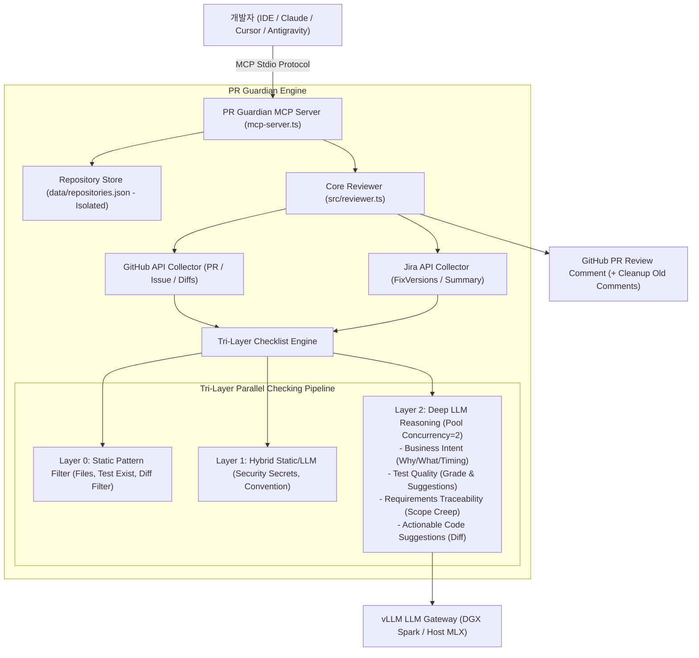

# PR Guardian Architecture

> **GitHub Copilot 수준의 프로젝트 이해도와 연관성 추적(Traceability)을 제공하는 개인화 코드 리뷰 엔진 & MCP 서버**

---

## 1. 시스템 개요 (System Overview)

PR Guardian은 단순한 diff 요약기를 넘어, **프로젝트 컨텍스트 ↔ 이슈 요구사항 ↔ 실제 변경 코드** 간의 삼각 일치성(Traceability)을 엄격하게 검증하고, GitHub Copilot 수준의 즉시 적용 가능한 코드 개선안(`suggestion`)을 도출하는 딥 체킹(Deep Checking) 리뷰 엔진입니다.



---

## 2. 핵심 아키텍처 원칙 (Core Architectural Principles)

### 1) 개인화 및 제로 트러스트 보안 격리 (Zero-Trust Security Isolation)
- 퍼블릭 레포지토리 배포 시 민감 데이터 유출을 방지하기 위해 `data/`, `outputs/`, `.env*`, `*.local.json`, `*.local.yaml`은 `.gitignore`로 완전 격리됩니다.
- 레포지토리 설정과 개인화 작업 목록은 로컬 파일시스템의 `data/repositories.json`을 통해 격리 관리됩니다.

### 2) 삼각 추적성 분석 (Triangular Traceability Analysis)
- **1차 (GitHub Mode):** GitHub Issue 요구사항 ↔ PR 개발 계획 ↔ 실제 소스코드 diff 비교 (`devcy0922/flevo` 등).
- **2차 (Jira Mode):** Jira Issue AC ↔ 브랜치/커밋 ↔ 소스코드 diff 비교 및 버전 마일스톤/프로젝트 보드 자동 연동.
- 누락된 요구사항(Gaps)과 범위 초과 변경(Scope Creep / Extras)을 정확하게 도출.

### 3) 원클릭 적용 가능한 코드 개선안 (Actionable Code Suggestions)
- 대용량 생성/락 파일(`openapi.json`, `pnpm-lock.yaml`)을 스마트 필터링하고 실제 소스코드만 추출.
- 단순 지적이 아닌 GitHub UI에서 즉시 커밋 가능한 ```suggestion 코드 블록을 함께 제공.

### 4) 고성능 동시성 제어 및 복원력 (Concurrency & Resilient Parsing)
- vLLM 큐 과부하 및 타임아웃을 방지하기 위해 `runWithConcurrency(tasks, 2)` 풀링을 적용.
- 모델의 사고 과정(thinking)과 마크다운이 혼재된 상황에서도 유효한 JSON을 완벽하게 추출하는 다중 후보 정규식 파서(`LLMClient.parseJson`) 내장.

---

## 3. 체크리스트 엔진 계층 구조 (Checklist Layering)

| 계층 | 검사 항목 | 판정 방식 | LLM 호출 |
|---|---|---|---|
| **Layer 0** | 수정 파일 분류 & 통계 | 정적 파일 확장자 매핑 | 0회 |
| **Layer 0** | 테스트 코드 존재 여부 | 테스트 경로 정규식 검사 | 0회 |
| **Layer 1** | 보안 시크릿 노출 검증 | 패턴 매칭 + 탐지 시 LLM 오탐 검증 | 0~1회 |
| **Layer 1** | 네이밍/커밋 컨벤션 | Conventional Commit & 브랜치 정규식 | 0회 |
| **Layer 2** | 비즈니스 의도 분석 | Why / What / Timing 심층 요약 | 1회 |
| **Layer 2** | 요구사항 추적성 (Traceability) | 이슈 요구사항 vs PR 계획 vs 실제 코드 | 1회 |
| **Layer 2** | 테스트 코드 품질 평가 | 테스트 설계, 경계값, Vitest 패턴, 등급(A~D) | 1회 |
| **Layer 2** | 실행 가능한 코드 개선안 | 런타임 버그, 타입 안전성, 보안 개선안 (Diff) | 1회 |

---

## 4. MCP 도구 명세 (Model Context Protocol Tools)

| 도구명 | 파라미터 | 반환값 | 설명 |
|---|---|---|---|
| `list_repositories` | 없음 | `RepositoryConfig[]` | 등록된 레포지토리 목록 및 설정 조회 |
| `add_repository` | `owner`, `repo`, `issueTracker`, `defaultBranch` | `RepositoryConfig` | 신규 레포지토리 로컬 등록 |
| `remove_repository` | `owner`, `repo` | `boolean` | 등록된 레포지토리 삭제 |
| `run_review` | `owner`, `repo`, `pullNumber`, `publishComment` | `ReviewResult` | 특정 PR에 대한 정밀 리뷰 실행 및 리포트 반환 |
| `list_pull_requests` | `owner`, `repo`, `state`, `limit` | `PullRequestSummary[]` | 대상 레포의 열린 PR 목록 조회 |
